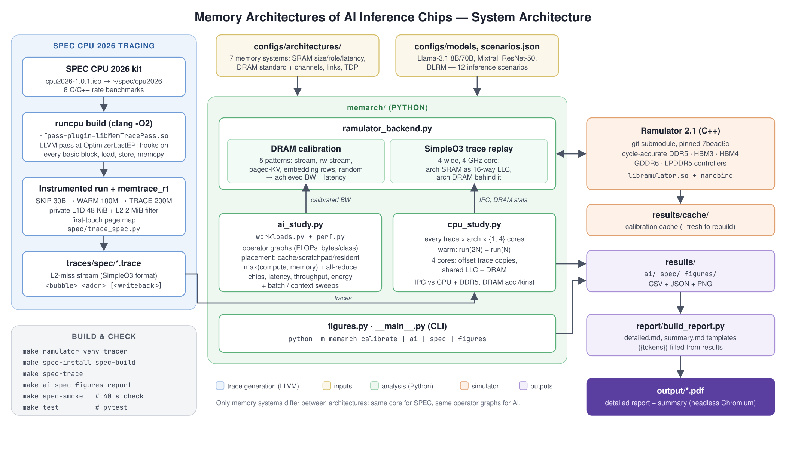

# Memory architecture of AI inference chips

How do the memory systems of AI inference chips — HBM GPUs, SRAM+GDDR6 meshes,
SRAM+LPDDR5 NPUs, SRAM-only LPUs and wafer-scale SRAM — behave on the AI
workloads they were built for, and on general-purpose code (SPEC CPU 2026)?


# Memory Architectures of AI Inference Chips — Technical Overview

## 1. Purpose

AI inference chips differ most in their **memory systems**, not their compute. This project
quantifies how those memory systems behave on 
(a) the AI workloads they were designed for and
(b) general-purpose code, 
using one consistent, cycle-accurate DRAM model underneath both.

Seven memory-system archetypes are compared (public-spec class parameters, not vendor models):

| Archetype               | On-chip SRAM role           | Off-chip memory |
| ----------------------- | --------------------------- | --------------- |
| CPU + DDR5              | Hardware cache (LLC)        | DDR5            |
| GPU + HBM3 / GPU + HBM4 | Small hardware cache        | HBM3 / HBM4     |
| NPU                     | Compiler-managed scratchpad | LPDDR5          |
| Dataflow mesh           | Compiler-managed scratchpad | GDDR6           |
| LPU-class               | All state resident in SRAM  | none            |
| Wafer-scale             | All state resident in SRAM  | none            |

## 2. Running It

| Step | Command |
|---|---|
| Ramulator + Python env | `git submodule update --init && make ramulator venv` |
| AI study | `make calibrate ai` (`--fresh` to bypass the calibration cache) |
| Tracer | `make tracer` |
| SPEC install/build/trace | `make spec-install spec-build spec-trace` |
| SPEC replay | `make spec` (≈3 h) — subsets: `--archs … --benchmarks … --cores … --merge` |
| Smoke test | `make spec-smoke` (≈40 s, results to `/dev/shm/memarch-smoke`) |
| Access patterns | `make patterns` (≈1 h): trace locality + inter-request PSD per DRAM system |
| Figures, PDFs, tests | `make figures report test` |


## 3. How It Works

### 3.1 DRAM calibration (cycle-accurate)
Each DRAM standard (DDR5, HBM3, HBM4, GDDR6, LPDDR5) is instantiated in Ramulator 2.1 with one
controller per channel (FR-FCFS scheduling, open-row policy, MOP4CLXOR address mapping,
refresh enabled). Five synthetic patterns mimic inference traffic classes:

1. **Stream** – sequential weight reads
2. **Read/write stream** – activations
3. **Paged-KV gather** – KV-cache blocks
4. **Embedding-row gather** – recommendation lookups
5. **Random 64 B** – worst case

Output: *achieved* bandwidth (% of pin peak) and loaded latency per (DRAM, pattern), cached in
`results/cache/`. HBM's `tick_multiplier = 2` is handled by using the controller tick period
(e.g. 312 ps for HBM3) when converting cycles to time.

Example: HBM3 sustains ~99% on streams but ~58% on random lines; GDDR6 drops to ~24%.

### 3.2 AI inference model (analytical, on top of calibration)
- **Workloads:** Llama-3.1 8B/70B decode and prefill, Mixtral-8x7B (MoE), ResNet-50,
  DLRM — 12 scenarios plus batch-size and context-length sweeps.
- **Operator graphs** record FLOPs and bytes per traffic class for each operator.
- **Placement** follows the SRAM role: cache (hit-rate based), scratchpad (pinned, overflow to
  DRAM), or resident (chip count set by capacity — the minimum number of chips that hold
  weights + KV cache).
- **Timing per operator:** `max(compute, memory) + all-reduce + overhead`, where memory time
  uses the calibrated bandwidth of the matching traffic class.
- **Energy:** dynamic memory energy (pJ/bit per technology) + links, and chips × TDP × time.
- **Outputs:** latency per token, chips required, throughput per chip, energy per token.

### 3.3 SPEC CPU 2026 study (trace-driven)
1. **Instrumentation.** `tracer/MemTracePass.cpp` is an LLVM pass plugin registered at
   `OptimizerLastEP` (runs after `-O2`). It inserts `__mt_bb(n)` at each basic block and
   `__mt_ld/__mt_st/__mt_range` before loads, stores, atomics and mem-intrinsics.
2. **Runtime.** `tracer/memtrace_rt.c` counts IR instructions and moves through
   SKIP (30B) → WARM (100M) → TRACE (200M) phases. It simulates the private L1D (48 KiB) and
   L2 (2 MiB) and emits only **L2 misses** as SimpleO3 lines `<bubble> <addr> [<writeback>]`,
   using a first-touch virtual→physical page map.
3. **Build.** `spec/build_spec.sh` drives `runcpu` with `spec/memtrace-llvm.cfg`
   (`clang -O2 -fpass-plugin=… ` + `memtrace_rt.o`) for eight C/C++ rate benchmarks.
4. **Trace.** `spec/trace_spec.py` runs each refrate workload with `MT_*` env vars.
5. **Replay.** `cpu_study.py` replays each trace on Ramulator's SimpleO3 core (4-wide, 4 GHz,
   128-entry window) with the architecture's SRAM as a 16-way LLC and its DRAM behind it.
   Warm measurement = run(2N) − run(N). 4-core runs use per-core trace copies in disjoint
   address ranges sharing LLC and DRAM. Metrics: IPC (vs CPU + DDR5), DRAM accesses per
   kilo-instruction, DRAM bandwidth and latency, row-hit rate.

## 4. System Architecture


**Directory map:** `configs/` (inputs), `memarch/` (simulation and analysis), `tracer/` (LLVM
instrumentation), `spec/` (SPEC build/trace scripts), `ramulator2/` (simulator submodule),
`results/` (CSV/JSON/figures, calibration cache), `report/` (Markdown templates + PDF builder),
`tests/` (pytest).


## 5. Limitations
Public-spec class parameters; analytical on-chip model over cycle-accurate DRAM; 16-bit
weights; one 200M-instruction window per SPEC benchmark, C/C++ only; instruction counts are
LLVM IR instructions (IPC ≠ x86 IPC); AI-chip SRAM latencies seen from a CPU core are assumed.


## What is in here

| Path | Contents |
|---|---|
| [configs/architectures/](configs/architectures) | 7 memory-system archetypes (SRAM size/role/latency/BW, DRAM standard and channels, compute, links, TDP) |
| [configs/models/](configs/models), [configs/scenarios.json](configs/scenarios.json) | Llama-3.1 8B/70B, Mixtral-8x7B, ResNet-50, DLRM-DCNv2; 12 inference scenarios |
| [memarch/ramulator_backend.py](memarch/ramulator_backend.py) | Builds Ramulator 2.1 DRAM systems; access-pattern calibration; SimpleO3 CPU-trace replay |
| [memarch/workloads.py](memarch/workloads.py) | Operator graphs with FLOPs and bytes per traffic class |
| [memarch/perf.py](memarch/perf.py) | Placement (cache / scratchpad / resident SRAM), roofline per op, collectives, energy |
| [memarch/ai_study.py](memarch/ai_study.py), [memarch/cpu_study.py](memarch/cpu_study.py) | The two studies |
| [memarch/access_patterns.py](memarch/access_patterns.py) | Access-pattern study: trace locality, DRAM command recording, inter-request PSD |
| [tracer/](tracer) | LLVM 23 pass plugin + runtime that turns any C/C++ program into a Ramulator trace |
| [spec/](spec) | SPEC CPU 2026 config, build script and trace driver |
| [results/](results) | CSV/JSON results and figures |
| [report/](report) | Report templates (`detailed.md`, `summary.md`) and the PDF builder |
| [tests/](tests) | `make test` |
| [papers/](papers) | Ramulator and NVMExplorer papers |

## Quick start

```bash
git submodule update --init   # Ramulator 2.1, pinned at 7bead6c
make ramulator     # CMake build: ramulator2/libramulator.so + Python bindings (~5 min)
make venv          # numpy, matplotlib, pytest, markdown, ruff
make ai figures    # Ramulator calibration + AI study (~5 min first time, cached after)
make report        # PDF via headless Chromium
make test
```

SPEC CPU 2026 (from `cpu2026-1.0.1.iso`, licensed separately and not redistributed):

```bash
make spec-install  # extract ISO to ~/spec/iso, install to ~/spec/cpu2026
make spec-build    # clang + MemTracePass build of the benchmarks in spec/benchmarks.txt
make spec-trace    # 200M-instruction L2-miss traces into traces/spec/
make spec-smoke    # ~40 s check: one short replay, results to /dev/shm/memarch-smoke
make spec          # replay on all architectures, 1 and 4 cores (about 3 hours on 12 threads)
make patterns      # access-pattern study: locality + inter-request PSD at the DRAM controllers (~1 h)
```

The vendor toolset links `libcrypt.so.1`; on distributions that ship only
`libcrypt.so.2` the Makefile/`spec/build_spec.sh` add a symlink shim in
`spec/.compat-lib` (same `XCRYPT_2.0` symbols). Fortran benchmarks are skipped
(no Fortran compiler).

Requirements: Python 3.14, CMake and a C++20 compiler for Ramulator, clang/LLVM 23
for the tracer, Chromium for the PDF. `libramulator.so` and the Python bindings are
build outputs of the `ramulator2` submodule (not committed); the Python extension is
built for the interpreter CMake finds, so build it with the same Python as `.venv`.

## Scope

Architecture parameters are public-spec class values, not vendor-calibrated
models. DRAM behaviour is cycle-accurate (Ramulator 2.1); the AI model is an
operator-level roofline on top of it; SPEC is replayed on a common
out-of-order core so only the memory system differs. See the Limitations
section of the report.
